# Test report: real-photos

- Branch: `feature/real-photos`, tested at commit `1380692`
- Spec: `docs/specs/real-photos.md`
- Test cases: `docs/test-cases/real-photos.md`

## Verdict: PASS

| Suite | Result |
|---|---|
| Lint | pass |
| Unit (Vitest) | 43 / 43 pass |
| E2E (Playwright, desktop + mobile, includes build) | 100 pass, 18 skipped (viewport-specific), 0 fail |

## Traceability

| AC | Test cases | Result |
|---|---|---|
| AC-1 | TC-5, TC-6 | Pass |
| AC-2 | TC-7 | Pass |
| AC-3 | TC-8 | Pass |
| AC-4 | TC-1 | Pass |
| AC-5 | TC-2, TC-10 | Pass |
| AC-6 | TC-11 | Pass |
| AC-7 | TC-3, TC-9 | Pass |
| AC-8 | TC-4, TC-12 | Pass |
| AC-9 | TC-13 | Pass |

## AC-5 screenshots (slider at 0% shows "after", at 100% shows "before")

| Item | 0% | 100% |
|---|---|---|
| Luxury SUV | 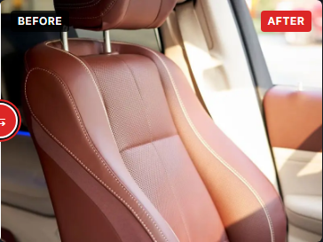 | 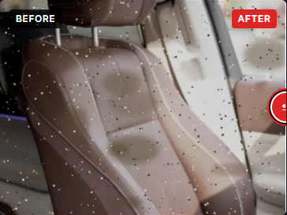 |
| Ford Mustang | 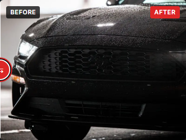 | 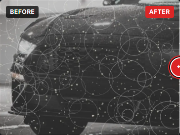 |
| Ford Explorer | 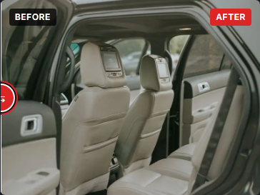 | 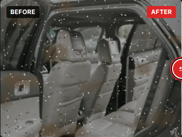 |
| Audi A6 | 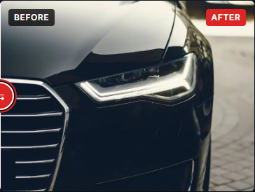 | 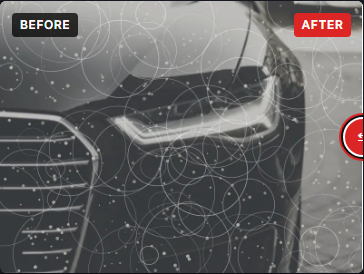 |
| Ford Focus RS | 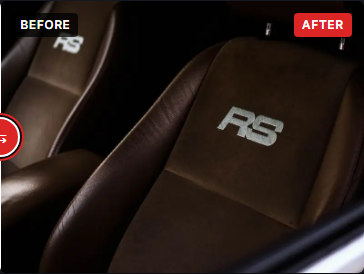 | 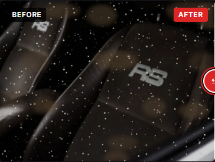 |
| Mercedes-Benz C-Class | 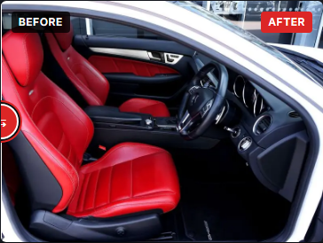 | 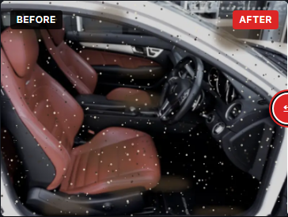 |

All six pairs show the same vehicle and framing. The "before" side is desaturated and hazy, with dust, stains or swirl rings, plain to see at card size.

## AC-6 manual check

No readable license plate. No face (the hero shows hands only). No other business's name or logo (the C-Class dealership background, zoomed 2x, is blurred with nothing readable). The "RS" seat embroidery is a maker badge, which is allowed. All images look like photographs, not renders.

## Issues opened

None.

## Observations (not filed)

- The simulated swirl marks are perfect circles that also cover glass and background, so up close they read as an overlay. Acceptable for the sales prototype under spec assumption 1; they must be replaced with real photos before going live.
- Code review: `src/data/detailingData.ts:24` keeps the stale comment "Google Business stays a Maps search until the real profile URL is provided", and line 25 has a trailing space after `=`. Style only.
- The vehicle models in the titles (Explorer, Focus RS, C-Class) are plausible from the photos but cannot be verified.

## Flaky tests

None.

## Spec issues

None.
